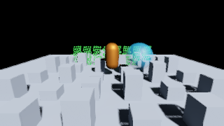

# Mobile 材质与 URP 14 对齐

移动 Lit 的金属度工作流采用 **URP 14.0.9** 的 BRDF 公式；Unlit 对齐基础颜色和透明混合的源颜色贡献。仍使用现有 HDRP/Lit、HDRP/Unlit 材质与常量布局，不增加 URP 运行时包依赖，不修改桌面 BRDF。

后续 [第二阶段改造](Mobile-Stability.md) 保持此 BRDF，并修正 Desktop 固定/物理曝光、HDRP Unlit 底色及自发光曝光权重，增加天空回退和实际材质画面回归；以下 85 项测试记录保留为本阶段历史基线。

参考固定为 Unity Graphics 提交 [`3d08aae65d6f0d39aac8f1cd2d8221c263da30c0`](https://github.com/Unity-Technologies/Graphics/tree/3d08aae65d6f0d39aac8f1cd2d8221c263da30c0/Packages/com.unity.render-pipelines.universal)，该提交的包版本为 14.0.9。测试目录保存上游 BRDF、依赖和 Unity Companion License；生产代码在 `Runtime/RenderPipeline/Mobile/Shaders/MobileBRDF.hlsl` 独立实现对应公式。

## 画面变化

- 漫反射使用 URP 的金属度能量分配和直接光归一化；取消旧移动实现额外的 Lambert `/PI`。
- 直接高光使用 URP 的 Minimalist Cook–Torrance、粗糙度下限与半精度高光限幅。光滑表面的高光宽度、峰值随之变化。
- 间接光加入非金属漫反射能量分配、掠射角 Fresnel 和粗糙度反射衰减；反射 Cubemap 使用 Core 的非线性粗糙度到 mip 映射。
- 法线解码使用 `UnpackNormalScale`，遵循平台法线纹理编码；切线空间转换保留插值后基向量，再归一化最终法线。
- Alpha/Additive 的 Preserve Specular Lighting 开关控制是否只对漫反射乘 alpha。关闭时整个源颜色乘 alpha；开启时保留高光与自发光。
- **Premultiply 按 URP 14 的预乘素材语义工作**：源 RGB 不再额外乘 alpha。此前依赖移动路径自动预乘的透明材质应改用 Alpha，或提供已预乘的素材。Lit 的 Premultiply 与 URP 一样忽略 Preserve Specular 开关。

## 对照材质的输入条件

| 输入 | 映射方式 |
| --- | --- |
| 基础颜色 | HDRP Base Color/Map 对应 URP Base Map/Color；Unlit 使用 HDRP Unlit Color/Map |
| 金属度、光滑度 | 无贴图时使用对应标量；有贴图时保持 HDRP Mask Map 的 R/A 通道及 remap，需与 URP **解码后的值**相同 |
| AO | HDRP Mask Map G 及 AO remap，对应 URP occlusion 的最终值；作用于间接光 |
| 法线 | 同一法线贴图、导入编码、强度、UV 与切线；移动路径仍只支持 UV0 |
| 自发光 | 对齐最终线性 HDR RGB；保留 HDRP Albedo Affect Emissive 与贴图属性 |
| 双面 | 保留 HDRP 的 Flip/Mirror/None。与 URP Cull Off 的普通背面行为比较时使用 None |
| 灯光 | 比较传入着色器的线性光颜色和衰减，而非不同灯光单位下相同的 Inspector 数字 |
| 曝光 | 使用等效固定曝光，比较线性 HDR 输出时关闭后处理；不要用曝光补偿掩盖材质差异 |

HDRP Mask Map 不能直接当作 URP Metallic Gloss Map 使用；原有 HDRP 贴图与材质无需批量改写。更换 BRDF 会改变当前移动画面，需要更新移动视觉基线。

## 验证与范围

2026-09-24，Unity 2022.3.17f1，Windows D3D11：完整 HDRP Editor 测试 **85/85 通过，0 失败、0 跳过**。其中新增 9 组 GPU 对照测试，各 8192 个样本，覆盖金属度、光滑度、视角、alpha、直接/间接 BRDF，以及 Lit/Unlit 的透明源贡献。逐通道误差上限为 `0.0002 * max(1, abs(reference))`。

参考 Pass 调用固定版本的上游函数，移动 Pass 调用生产 BRDF；参考文件只调整了两个相对 include 路径。透明测试比较混合前的有效源贡献，不等于对所有目标缓冲混合状态的完整图像测试。报告见 [NUnit XML](MobileValidation/URP14Tests.xml)。

实际离屏检查同时通过：Lit/Unlit、Alpha、裁剪、错误材质、多相机与主光阴影；阴影接收区域检测到 1,054 个变暗像素。桌面/移动关键 Pass 及功能变体编译通过。Android Vulkan Shader 编译、Player C# 编译、IL2CPP 转换和 ARM64 Gradle 工程导出成功，导出入口返回 0；这不代表 APK 打包或真机安装成功。

下面是更新后的烘焙场景 320×180 功能快照，不是 URP 全管线图像对照，也不是 1080p 性能测试：

此对齐针对基础 metallic Lit/Unlit 材质模型。Shader Graph、Specular 工作流、Clear Coat 等仍不在移动支持范围内。HDRP 烘焙数据/探针卷积、阴影过滤、雾、曝光与色调映射实现会影响最终画面，不承诺完整场景与 URP 逐像素一致。D3D11 GPU 对照不替代 Android 半精度和真机视觉验收。
