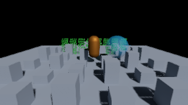

# Mobile Renderer 验证记录

验证日期：2026-09-24。环境：Unity 2022.3.17f1 / HDRP 14.0.9，Windows，D3D11，NVIDIA GeForce RTX 3060 Laptop GPU。以下结果不能代替手机性能测试。

最新第二阶段结果见 [正确性、曝光与天空回退](Mobile-Stability.md)：118/118 Editor 测试及六轮播放生命周期检查通过。下方是早期验证记录。

后续材质对齐 URP 14.0.9 的结果见 [材质对齐记录](Mobile-URP14-Alignment.md)：85/85 Editor 测试、离屏渲染和 Android 工程导出通过。下方保留初始移动实现的 76 项测试与旧画面基线。

## 已通过

- 完整 HDRP Editor 测试：**76/76，通过；失败 0，跳过 0**。包括旧 Asset 默认 Desktop、移动平台限制、桌面管理器隔离、重复释放、连续 Mobile backend 替换、原生反射探针绑定与恢复、显式 RenderTexture 尺寸及原有桌面测试。
- 最终 D3D11 Shader 检查：Lit/Unlit 桌面与移动关键 Pass、阴影、选择/拾取、Lightmap、方向性 Lightmap、实例化及材质功能变体编译成功。
- 离屏画面检查：Unlit、Lit、Alpha 透明、Alpha Clip、错误材质、多相机状态，以及实际主光投影。阴影测试在排除投影物自身屏幕区域后检测到 **1,171 个接收阴影变暗的像素**。
- 基准场景通过 Desktop HDRP 烘焙：两张 Lightmap、Light Probe SH、HDRP 反射 Cubemap；最终烘焙无 UV 重叠警告。Android 必须使用 High Quality Lightmap Encoding，否则物理光强会被低动态范围编码截断。
- 检查中修复了 HDRP 与原生 ReflectionProbe 的纹理存储差异：移动路径在剔除前同步烘焙 Cubemap，探针停用或管线释放时恢复原状态。
- 最终 Android 导出成功：Vulkan Shader 编译/裁剪、Player C# 编译、IL2CPP 转换及 ARM64 Gradle 工程导出完成。导出工程包含后续原生构建所需的 IL2CPP 源码；它不是 APK，也不代表最终版本已完成 Gradle/NDK 链接或安装运行。
- 批处理在切换平台后立即截图曾出现无效的烘焙画面；入口现在等待编辑器更新和导入完成，并检查中性受光像素。最终 Win64 → Android 切换后的截图断言与工程导出均通过。

[完整 NUnit 测试报告](MobileValidation/EditorTests.xml)

下面是 320×180 离屏功能快照；它不是固定 1080p 的性能测试结果。

## 尚未通过验收的部分

- APK：首次 Vulkan Shader 与 ARM64 IL2CPP 原生编译完成，但 Gradle 卡在 HTTPS 依赖下载；已终止该打包进程。离线重试确认缺少多个缓存依赖，包括 `jsr305:3.0.2`、`checker-qual:3.5.0` 等。没有生成可宣称安装验证成功的 APK。
- 无已连接的 Android 设备。尚未执行 Adreno/Mali 安装运行、GPU 捕帧、五分钟预热与十分钟连续采样，不能声称达到固定 1080p、P95 ≤ 16.67 ms。
- 桌面关键 Shader 和原有 Editor 测试已通过；尚无用户项目的批准画面基线，因此不宣称完成项目级桌面图像回归。
- 编辑器手动交互、反复进入播放/脚本重载后的长期资源趋势，及完整内容矩阵的真机图像基线仍需集成验收。

## 复现入口

仅在**独立、可丢弃的验证工程**运行以下批处理入口；它们会配置该工程的场景和 Graphics/Quality/Player 设置：

| 入口 | 用途 |
| --- | --- |
| `UnityEditor.Rendering.HighDefinition.MobileRenderValidation.Run` | Shader 编译与离屏画面检查 |
| `UnityEditor.Rendering.HighDefinition.MobileRenderValidation.BakeBenchmark` | Desktop 平台下烘焙验证样例 |
| `UnityEditor.Rendering.HighDefinition.MobileRenderValidation.ExportAndroid` | 导出 Vulkan ARM64 IL2CPP Gradle 工程 |
| `UnityEditor.Rendering.HighDefinition.MobileRenderValidation.BuildAndroid` | 依赖环境就绪后构建 APK |

运行完整测试时使用已持久化的 Desktop Asset 和 Windows 活动平台；Android 活动平台会使原有桌面路径按原规则跳过渲染。测试程序集为 `Unity.RenderPipelines.HighDefinition.Editor.Tests`。

使用说明见 `Mobile-Renderer.md`；导入样例见包管理器的 **Mobile Renderer Benchmark**。
